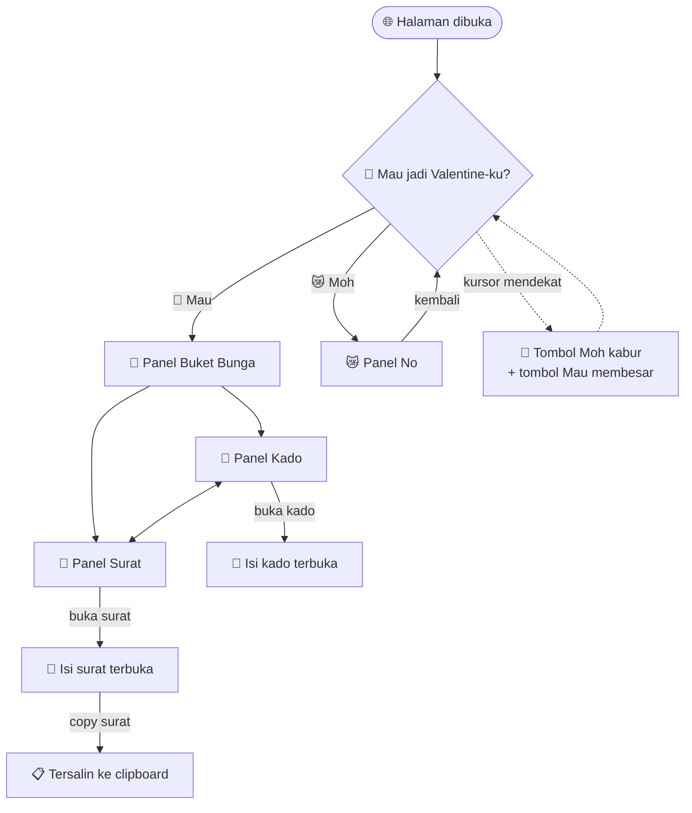

<div align="center">

# 💜 Valentine 26

### Kartu Valentine interaktif bertema ungu dengan efek *glassmorphism*

*Satu halaman web kecil, dibuat dengan penuh cinta untuk orang tersayang.* 🌷

<br>


<br>

[✨ Fitur](#-fitur) •
[🎬 Alur Halaman](#-alur-halaman) •
[🛠️ Teknologi](#️-teknologi) •
[📁 Struktur](#-struktur-proyek) •
[🚀 Menjalankan](#-cara-menjalankan) •
[🌐 Deploy](#-deploy-ke-github-pages) •
[✏️ Kustomisasi](#️-cara-kustomisasi)

</div>

---

## 💌 Tentang Proyek

**Valentine 26** adalah halaman web statis berisi kejutan Valentine yang interaktif. Penerima akan diajak memilih jawaban, lalu mendapat **buket bunga animasi**, **kado** yang bisa dibuka, dan **surat cinta** yang bisa disalin.

Seluruh proyek hanya satu file HTML (`v.html`) tanpa framework dan tanpa dependensi apa pun, jadi ringan dan mudah diubah.

> 💡 **Ide utamanya:** tombol **"Moh"** (tidak) akan *kabur* setiap kali didekati kursor, sementara tombol **"Mw"** (ya) terus membesar. Jadi satu-satunya pilihan yang masuk akal hanyalah *ya*. 😼

---

## ✨ Fitur

| | Fitur | Keterangan |
|:-:|---|---|
| 💜 | **Floating Hearts** | Emoji hati ungu transparan melayang naik tanpa henti dengan ukuran dan kecepatan acak |
| 🪟 | **Glassmorphism** | Kartu dan panel berbahan kaca buram (`backdrop-filter: blur`) dengan border putih lembut |
| 😼 | **Tombol "Moh" Kabur** | Tombol penolakan berpindah posisi acak saat kursor mendekat (`onmouseover`) |
| 📈 | **Tombol "Mau" Membesar** | Tombol persetujuan otomatis membesar dan bercahaya tiap tombol "Moh" kabur |
| 💬 | **Pesan Usil** | Muncul teks jahil saat penerima mencoba menekan tombol penolakan |
| 💐 | **Buket Animasi** | Lima bunga (💐 🌷 🌸 🌹 🌼) bergoyang lembut dengan animasi bergelombang |
| 🎁 | **Kado Interaktif** | Kado yang bisa dibuka dan ditutup, berisi kejutan emoji |
| 💌 | **Surat Cinta** | Amplop yang bisa dibuka, lengkap dengan tombol **copy surat** ke clipboard |
| 😿 | **Panel "No"** | Halaman khusus jika penerima nekat memilih tidak, lengkap dengan tombol kembali |
| 📱 | **Responsif** | Tampilan menyesuaikan layar HP maupun desktop |

---

## 🎬 Alur Halaman



---

## 🛠️ Teknologi

| Teknologi | Kegunaan |
|---|---|
| **HTML5** | Struktur halaman dalam satu file (`v.html`) |
| **CSS3** | Gradien, glassmorphism, `@keyframes` animasi, dan layout flexbox |
| **JavaScript (Vanilla)** | Navigasi antar panel, animasi tombol kabur, hati melayang, dan Clipboard API |
| **GitHub Actions** | Deploy otomatis ke GitHub Pages setiap push ke `main` |

### 🎨 Palet Warna

| Warna | Kode | Penggunaan |
|:-:|---|---|
|  | `#d9c2ff` | Gradien background (awal) |
|  | `#c2a5ff` | Gradien background (tengah) |
|  | `#e5d5ff` | Gradien background (akhir) |
|  | `rgba(190,150,255)` | Tombol utama |
|  | `#4e2d62` | Warna teks |

---

## 📁 Struktur Proyek

```text
valentine26/
├── 📂 .github/
│   └── 📂 workflows/
│       └── ⚙️ static.yml     # Workflow deploy otomatis ke GitHub Pages
└── 💜 v.html                  # Halaman utama (HTML + CSS + JS)
```

---

## 🚀 Cara Menjalankan

### Opsi 1 — Langsung di Browser
```bash
git clone https://github.com/NabilSuryaa/valentine26.git
cd valentine26
```
Lalu **double-click** file `v.html`. Tidak perlu instalasi apa pun.

### Opsi 2 — Dengan Local Server
```bash
# Python
python -m http.server 8000

# atau Node.js
npx serve .
```
Buka **http://localhost:8000/v.html** di browser.

---

## 🌐 Deploy ke GitHub Pages

Proyek ini sudah dilengkapi workflow `static.yml` yang akan men-deploy seluruh isi repo secara otomatis setiap kali ada **push ke branch `main`**.

**Aktifkan sekali saja:**
1. Buka repository di GitHub → **Settings → Pages**
2. Pada **Build and deployment → Source**, pilih **GitHub Actions**
3. Push perubahan ke `main`, lalu pantau prosesnya di tab **Actions**
4. Setelah hijau ✅, halaman bisa dibuka di:

```text
https://nabilsuryaa.github.io/valentine26/v.html
```

> 📌 **Catatan:** karena file utamanya bernama `v.html` (bukan `index.html`), alamat dasar `https://nabilsuryaa.github.io/valentine26/` akan menampilkan *404*. Untuk membuka langsung dari alamat dasar, ubah nama `v.html` menjadi `index.html`.

### Rangkuman Workflow `static.yml`

| Langkah | Fungsi |
|---|---|
| **Checkout** | Mengambil isi repository |
| **Setup Pages** | Menyiapkan konfigurasi GitHub Pages |
| **Upload artifact** | Mengunggah seluruh repo (`path: '.'`) |
| **Deploy to GitHub Pages** | Mempublikasikan situs |

Workflow juga bisa dijalankan manual lewat **Actions → Run workflow** (`workflow_dispatch`).

---

## ✏️ Cara Kustomisasi

Semua isi ada di `v.html`. Cari bagian berikut untuk menyesuaikannya:

| Ingin mengubah… | Cari di `v.html` |
|---|---|
| Pertanyaan utama | Elemen `.ngeselin-text` |
| Teks tombol Ya / Tidak | Tombol `#yesBtn` dan `#noBtn` |
| Pesan jahil saat "Moh" ditekan | Variabel `msg.innerHTML` di fungsi `runAway()` |
| Bunga di buket | Elemen `.flower-emoji` di dalam `.flower-arrangement` |
| Isi kado | Elemen `.gift-open-content` |
| Isi surat | Elemen `.message-paper` |
| Teks yang disalin | Variabel `text` di fungsi `copyMessage()` |
| Warna tema | Nilai `rgba(...)` dan gradien pada `body` di bagian `<style>` |
| Kecepatan hati melayang | Interval `setInterval(createHeart, 300)` (makin kecil, makin banyak) |

> 💡 **Tips:** teks surat di layar (`.message-paper`) dan teks yang disalin (`copyMessage()`) ditulis terpisah. Ubah keduanya supaya isinya sama.

---

## 📸 Pratinjau

> Tambahkan screenshot supaya README makin menarik:
> 1. Simpan gambar di folder `screenshots/`
> 2. Tampilkan dengan baris berikut:
>
> ```markdown
> 
> ```

---

<div align="center">

<br>

**Dibuat dengan 💜 oleh [NabilSuryaa](https://github.com/NabilSuryaa)**

*Valentine 2026*

</div>
